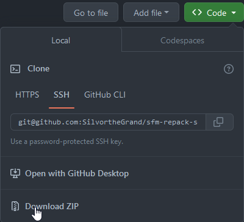
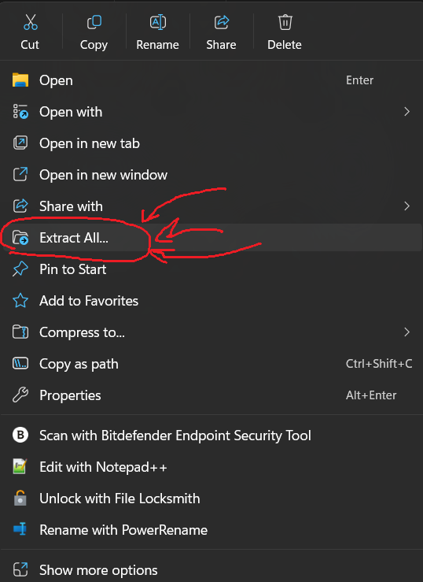
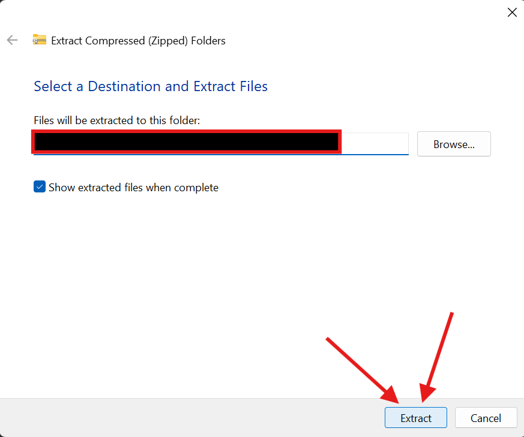
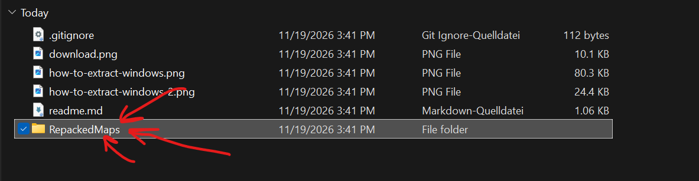
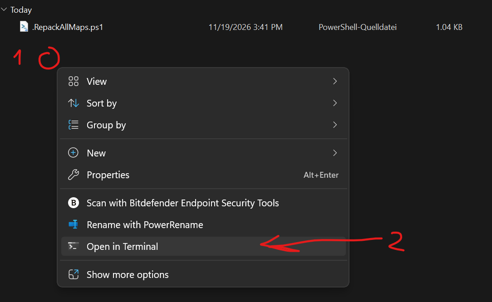
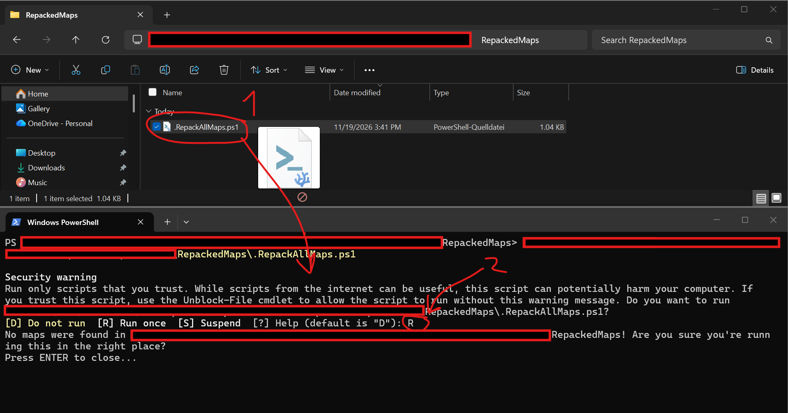

# Silvor's batch repacking script
This script is quite simple. It takes your standard tf2 maps and repackages them for SFM. This can normally be done [like this](https://web.archive.org/web/20261119141416/https://steamcommunity.com/sharedfiles/filedetails/?id=480267373), but the process is pretty time consuming and I couldn't be bothered to paste the same command a million times, so I made a script that does it automatically.

### Installation
All you've got to do is download the zip like this:

**Copy the downloaded file into the `Team Fortress 2/bin/` folder**, then extract with your program of choice.

On Windows 11, you can do it like this:
Right click on the file and then click "Extract All...".

If you get a confirmation message, then just click "Extract".

### Actually Using the Script
After doing the steps above, a new window should open with a folder like this. Enter it.

In that folder, there should be another folder called `RepackagedMaps`. Enter it.

Copy all the maps you want to repack for SFM into this folder, then continue with the next step.

Now comes the hard part, the scary terminal. You will need to right-click in that folder somewhere where there is neither a file nor a folder. Then, you select "Open in Terminal".

Now we'll actually convert your maps. And I lied, the real hard part comes now. You will need to drag & drop the file called `RepackAllMaps.ps1` into the terminal. You may be prompted with the same message that I was, asking you if you really wanna run the script. You may then consider if you really do want to convert your maps and, if you decide that you really do wanna do that, then you confirm that you wanna run the script by entering the appropriate letter. In my case that's "R". Then, you press enter to run.

Congratulations, your maps should now be converted!

### Troubleshooting
Consult the [guide](https://web.archive.org/web/20261119141416/https://steamcommunity.com/sharedfiles/filedetails/?id=480267373) I used as a basis for this script. It contains a section about troubleshooting that you should adhere to.
